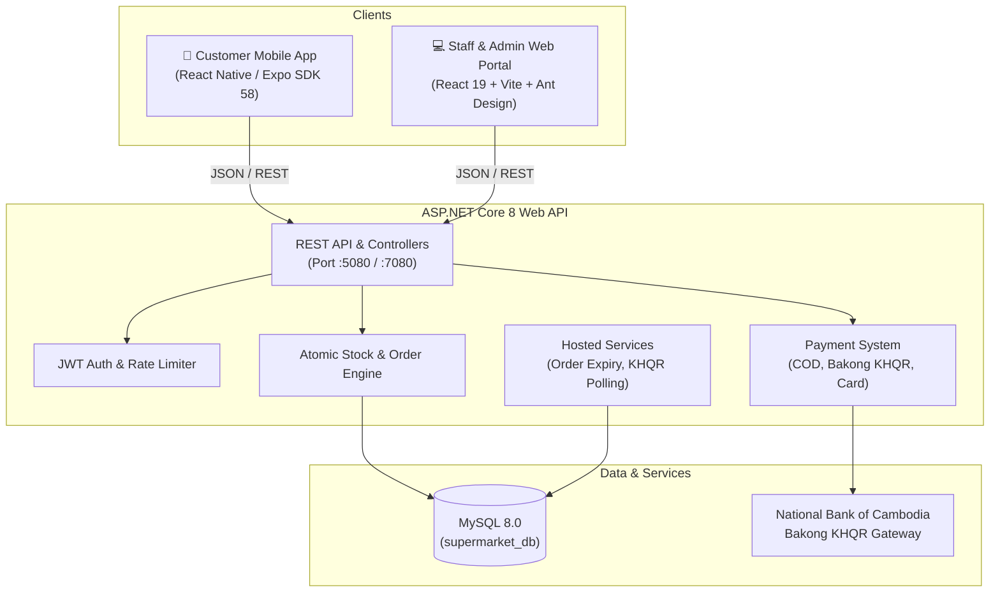

# 🛒 Supermarket (Blue Panda) — Full-Stack E-Commerce & Retail Management Platform

[](https://dotnet.microsoft.com/)
[](https://www.mysql.com/)
[](https://react.dev/)
[](https://expo.dev/)
[](https://www.typescriptlang.org/)
[](https://vitejs.dev/)

An end-to-end retail platform composed of a high-performance **ASP.NET Core 8 Web API**, an administrative **Staff & Admin Web Portal** (React 19 + Vite), and a cross-platform **Customer Mobile App** (React Native with Expo SDK 58). Supports real-time stock reservation, Bakong KHQR payments, sandbox card transactions, and granular staff HR and inventory control.

---

## 📑 Table of Contents

- [System Architecture](#-system-architecture)
- [Repository Structure](#-repository-structure)
- [Key Features](#-key-features)
  - [1. Customer Mobile App](#1-customer-mobile-app-frontendmobile)
  - [2. Staff & Admin Web Portal](#2-staff--admin-web-portal-frontendweb)
  - [3. Backend Web API](#3-backend-web-api-backendsupermarket_api)
- [Prerequisites](#-prerequisites)
- [Quick Start Guide](#-quick-start-guide)
  - [1. Database Setup](#1-database-setup)
  - [2. Backend Setup](#2-backend-setup)
  - [3. Staff Web Portal Setup](#3-staff-web-portal-setup)
  - [4. Customer Mobile App Setup](#4-customer-mobile-app-setup)
- [Default Development Accounts & Test Data](#-default-development-accounts--test-data)
- [API Endpoints Overview](#-api-endpoints-overview)
- [Configuration Reference](#-configuration-reference)
- [Troubleshooting & FAQs](#-troubleshooting--faqs)

---

## 🏛 System Architecture



---

## 📂 Repository Structure

```
Supermarket_API/
├── backend/
│   ├── Supermarket.sln                  # Visual Studio solution file
│   ├── Supermarket_API/                 # ASP.NET Core 8 Web API project
│   │   ├── Controllers/                 # REST endpoints (Auth, Catalog, Cart, Orders, Admin, Staff)
│   │   ├── Data/                        # ApplicationDbContext & DevSeeder
│   │   ├── DTOs/                        # Request & response transfer objects
│   │   ├── Migrations/                  # EF Core database migrations
│   │   ├── Models/                      # Domain entities (Customer, Employee, Product, Order, etc.)
│   │   ├── Services/                    # Core business logic & payment providers
│   │   ├── Program.cs                   # App bootstrapping, DI, security middleware
│   │   └── appsettings.json             # Environment defaults
│   └── tests/Supermarket.API.Tests/     # Unit and integration test suite
│
├── frontend/
│   ├── mobile/                          # Customer Mobile Application (React Native / Expo)
│   │   ├── src/
│   │   │   ├── api/                     # Axios API clients with auto auth-token injection
│   │   │   ├── components/              # Reusable UI widgets & interactive credit card preview
│   │   │   ├── config/                  # Platform-aware network host detection (10.0.2.2 vs LAN)
│   │   │   ├── navigation/              # React Navigation (Tabs, Auth Stack, Root Stack)
│   │   │   ├── screens/                 # Mobile views (Shop, Cart, Checkout, KHQR, Orders, Account)
│   │   │   └── store/                   # Zustand state stores (Cart & Auth persistence)
│   │   ├── package.json
│   │   └── app.json                     # Expo SDK 58 application config
│   │
│   └── web/                             # Staff & Admin Web Portal (React 19 / Vite)
│       ├── src/
│       │   ├── api/                     # Web API client endpoints
│       │   ├── components/              # Navigation layout, guards, modals, payment preview
│       │   ├── pages/                   # Admin & Staff views (Products, Stock, Orders, HR Users)
│       │   ├── store/                   # Redux Toolkit store (auth & cart slices)
│       │   └── main.tsx
│       ├── package.json
│       └── vite.config.ts               # Vite proxy configuration for local dev
│
└── README.md
```

---

## ✨ Key Features

### 1. Customer Mobile App (`frontend/mobile`)
- **Modern Shopping Experience:** Clean tab-based navigation with Hero banners, popular category chips, and live search.
- **Dynamic Category Filtering:** One-tap category chips that navigate to catalog filtered by aisle with instant search.
- **Server-Synchronized Cart:** Real-time stock validation, quantity adjusters, and empty-state guidance.
- **Comprehensive Checkout:**
  - Multi-address selection & new address creation.
  - Payment method choices: **Cash on Delivery (COD)**, **Bakong KHQR**, and **Credit / Debit Card**.
- **Interactive Payments:**
  - **Bakong KHQR:** Real-time QR code rendering with countdown timer, deep link app opening, and automatic transaction status detection.
  - **Credit Card:** Live 3D-styled card preview with real-time formatting for card number, expiration, and CVV, backed by sandbox payment confirmation.
- **Self-Service Order Management:** Real-time order progress timeline, order history, full item breakdown, and cancellation for pending orders.
- **Secure Authentication & OTP Password Recovery:** Token persistence via `expo-secure-store`, password reset code verification flow, and account management.

### 2. Staff & Admin Web Portal (`frontend/web`)
- **Admin Dashboard:** Overview of supermarket operational metrics, order flows, and stock statuses.
- **Catalog Management:** Create, edit, and archive products, assign categories, and update pricing.
- **Inventory Control:**
  - Real-time stock audit list.
  - Stock adjustment logging with reasons (restock, breakage, recount) restricted by `ManageStock` permission.
- **Order Lifecycle Management:** Step orders through `Pending` ➔ `Processing` ➔ `Shipped` ➔ `Completed` or `Cancelled`.
- **Employee & Staff HR Management:**
  - Create staff logins and associate them with dedicated Employee profiles (Department, Position, Hire Date, Salary).
  - Granular role-based access control (RBAC) and claim-based permission assignment (`ManageStock`, `ManageProducts`, `ManageCategories`).
  - One-click account activation / deactivation.

### 3. Backend Web API (`backend/Supermarket_API`)
- **ASP.NET Core 8 & Entity Framework Core:** High-throughput async endpoints with Pomelo MySQL driver.
- **Automatic Migration & Seeder on Startup:** Development environment automatically runs pending database migrations and seeds initial admin/staff roles and products.
- **Atomic Stock Management:** Reserves inventory during order creation and rolls back automatically if orders are cancelled or unpaid after the grace period.
- **Hosted Background Workers:**
  - `UnpaidOrderExpiryService`: Automatically expires unpaid orders after 30 minutes.
  - `PaymentVerificationService`: Polls Bakong KHQR settlement when live payments are active.
- **Security Hardened:** Rate limiting on auth endpoints (10 req/min per IP), Kestrel request body constraints, security response headers (`nosniff`, `DENY`), and JWT Bearer validation.

---

## 📦 Prerequisites

Ensure you have the following installed on your development machine:

| Tool | Version Requirement | Description |
|---|---|---|
| **.NET SDK** | `8.0` or higher | Core backend runtime & CLI |
| **MySQL Server** | `8.0` or MariaDB `10.5+` | Primary relational database (port 3306) |
| **Node.js** | `20.x` or higher | JavaScript runtime for Web & Mobile |
| **npm** | `10.x` or higher | Package manager |
| **Android Studio** | Latest | Required for running the Android Emulator (with Google Play) |
| **Expo Go** *(Optional)* | Latest | Required if running the mobile app on a physical iOS/Android device |

---

## 🚀 Quick Start Guide

### 1. Database Setup

Ensure MySQL is running on port `3306`. Connect to MySQL via terminal or MySQL Workbench and create the database:

```sql
CREATE DATABASE supermarket_db CHARACTER SET utf8mb4 COLLATE utf8mb4_unicode_ci;
```

---

### 2. Backend Setup

Navigate to the backend directory:

```bash
cd backend/Supermarket_API
```

#### Set User Secrets (or configure `appsettings.Development.json`)
The connection string and JWT key are configured for development. If using Visual Studio:
1. Right-click `Supermarket_API` ➔ **Manage User Secrets**.
2. Supply your credentials based on `backend/secrets.template.json`:

```json
{
  "ConnectionStrings:DefaultConnection": "Server=localhost;Port=3306;Database=supermarket_db;User=root;Password=YOUR_MYSQL_PASSWORD;",
  "Jwt:Key": "supermarket_secret_key_super_secure_minimum_32_characters_long",
  "Bakong:Token": ""
}
```

#### Run Database Migrations
In development, the API runs migrations automatically on boot. To apply them manually:

- **Via .NET CLI:**
  ```bash
  dotnet ef database update
  ```
- **Via Visual Studio Package Manager Console:**
  ```powershell
  Update-Database
  ```

#### Launch the Web API
Run the backend with the HTTP profile (listens on `http://0.0.0.0:5080`):

```bash
dotnet run --launch-profile http
```

- **Swagger Documentation:** Available at [http://localhost:5080/swagger](http://localhost:5080/swagger)
- **Health Check Endpoint:** [http://localhost:5080/health](http://localhost:5080/health)

---

### 3. Staff Web Portal Setup

Open a new terminal window:

```bash
cd frontend/web
npm install
```

#### Start Vite Development Server
```bash
npm run dev
```

The web portal will open at [http://localhost:5173](http://localhost:5173).  
Vite automatically proxies API requests from `/api` to `http://localhost:5080`, so no manual CORS configuration is necessary.

---

### 4. Customer Mobile App Setup

Open a new terminal window:

```bash
cd frontend/mobile
npm install
```

#### Networking Configuration
The mobile app includes smart host detection in `src/config/api.ts`:
- **Android Studio Emulator:** Automatically routes to `http://10.0.2.2:5080/api`.
- **Physical Device via Wi-Fi:** Set the environment variable to your computer's local LAN IP:
  ```bash
  # Example for Windows PowerShell:
  $env:EXPO_PUBLIC_API_URL="http://192.168.1.15:5080/api"
  ```

#### Run the Mobile App
```bash
npx expo start
```

- **Android Studio Emulator:** Press **`a`** in the terminal to launch on the running Android emulator.
- **Physical Device:** Install the **Expo Go** app from Google Play / App Store, ensure your phone is connected to the same Wi-Fi network as your PC, and scan the terminal QR code.

---

## 🔑 Default Development Accounts & Test Data

In `Development` mode, `DevSeeder` automatically creates testing accounts with preset credentials:

| Role | Email | Password | Permissions & Scope |
|---|---|---|---|
| **System Admin** | `admin@supermarket.com` | `Admin@123` | Full access to products, staff HR, orders, categories |
| **Store Staff** | `staff@supermarket.com` | `Staff@123` | Access to inventory viewer & stock management |
| **Customer** | Register in mobile/web | Custom | Shopping, cart, checkout, order tracking |

### Sandbox Payment Testing

- **Bakong KHQR:** Click the **"Simulate payment"** button on the payment screen to mimic bank transfer confirmation without an active NBC connection.
- **Credit / Debit Card:** Enter any test card details. For standard testing:
  - **Card Number:** `4242 4242 4242 4242`
  - **Expiry:** Any future date (e.g., `12/28`)
  - **CVV:** Any 3 digits (e.g., `123`)
  - **Name on Card:** Any cardholder name
- **Password Reset Code (Dev Mode):** Check API terminal logs or use the default seeded OTP: `123456`.

---

## 📡 API Endpoints Overview

All endpoints are prefixed with `/api`. Authenticated endpoints require `Authorization: Bearer <jwt_token>`.

### Authentication & Account (`/api/auth`)
| Method | Endpoint | Description | Auth Required |
|---|---|---|---|
| `POST` | `/api/auth/register` | Register a new customer account | No |
| `POST` | `/api/auth/login` | Login with email and password | No |
| `GET` | `/api/auth/me` | Fetch authenticated customer profile | Yes |
| `POST` | `/api/auth/forgot-password` | Request password reset code via email | No |
| `POST` | `/api/auth/verify-reset-code` | Verify 6-digit OTP code | No |
| `POST` | `/api/auth/reset-password` | Set new password with verified code | No |

### Catalog & Categories (`/api/products`, `/api/categories`)
| Method | Endpoint | Description | Auth Required |
|---|---|---|---|
| `GET` | `/api/categories` | List active categories / aisles | No |
| `GET` | `/api/products` | Search & filter products (paged) | No |
| `GET` | `/api/products/{id}` | Retrieve product details | No |

### Shopping Cart (`/api/cart`)
| Method | Endpoint | Description | Auth Required |
|---|---|---|---|
| `GET` | `/api/cart` | Get current customer's cart | Customer |
| `POST` | `/api/cart/items` | Add item to cart | Customer |
| `PUT` | `/api/cart/items/{id}` | Update quantity of cart item | Customer |
| `DELETE`| `/api/cart/items/{id}` | Remove item from cart | Customer |
| `DELETE`| `/api/cart` | Clear entire cart | Customer |

### Orders & Checkout (`/api/orders`, `/api/addresses`)
| Method | Endpoint | Description | Auth Required |
|---|---|---|---|
| `GET` | `/api/addresses` | List customer delivery addresses | Customer |
| `POST` | `/api/addresses` | Create new delivery address | Customer |
| `POST` | `/api/orders` | Place order & atomically reserve stock | Customer |
| `GET` | `/api/orders` | List customer's orders | Customer |
| `GET` | `/api/orders/{id}` | Retrieve specific order details | Customer |
| `POST` | `/api/orders/{id}/cancel` | Cancel unpaid/unprocessed order | Customer |

### Payments (`/api/orders/{id}/payments`, `/api/payments`)
| Method | Endpoint | Description | Auth Required |
|---|---|---|---|
| `POST` | `/api/orders/{id}/payments` | Initiate payment (COD, KHQR, Card) | Customer |
| `GET` | `/api/orders/{id}/payments` | Get payment status & QR data | Customer |
| `POST` | `/api/payments/{id}/check` | Re-verify payment with gateway | Customer |
| `POST` | `/api/payments/{id}/sandbox-confirm` | Confirm sandbox payment (Dev only)| Development |

### Staff & Inventory Management (`/api/inventory`)
| Method | Endpoint | Description | Auth Required |
|---|---|---|---|
| `GET` | `/api/inventory` | View current inventory levels | Staff / Admin |
| `GET` | `/api/inventory/movements` | View stock adjustment history | Staff / Admin |
| `POST` | `/api/inventory/adjust` | Record stock count adjustment | Permission: `ManageStock` |

### Admin Administration (`/api/admin`)
| Method | Endpoint | Description | Auth Required |
|---|---|---|---|
| `GET/POST` | `/api/admin/products` | Create and manage products | Admin |
| `GET/POST` | `/api/admin/categories`| Create and manage categories | Admin |
| `GET/PUT`  | `/api/admin/orders` | View and progress order statuses | Admin |
| `GET/POST` | `/api/admin/users` | Manage staff accounts and HR info | Admin |
| `PUT` | `/api/admin/users/{id}/employee` | Update employee salary/department | Admin |
| `PUT` | `/api/admin/users/{id}/roles` | Assign or remove user roles | Admin |

---

## ⚙️ Configuration Reference

Key options inside `backend/Supermarket_API/appsettings.json`:

```json
{
  "Jwt": {
    "Issuer": "Supermarket.API",
    "Audience": "Supermarket.Client",
    "ExpiryMinutes": 60
  },
  "Delivery": {
    "FlatFee": 1.50,
    "FreeDeliveryThreshold": 20.00
  },
  "Payment": {
    "UnpaidOrderExpiryMinutes": 30
  },
  "RateLimiting": {
    "AuthRequestsPerMinute": 10
  },
  "Bakong": {
    "Enabled": false,
    "BaseUrl": "https://api-bakong.nbc.gov.kh/v1",
    "AccountId": "merchant@acleda",
    "MerchantName": "Supermarket Blue Panda"
  }
}
```

---

## 🛠 Troubleshooting & FAQs

### 1. Mobile App: "Network Error" when connecting to Backend
- **Android Studio Emulator:** Ensure the backend is listening on `http://0.0.0.0:5080`. In emulator, `localhost` refers to the emulator itself; the mobile code uses `10.0.2.2:5080` to reach the PC host.
- **Physical Device:** Ensure your phone and PC are on the same Wi-Fi network. Check Windows Firewall to ensure inbound port `5080` is open, and start Expo with `$env:EXPO_PUBLIC_API_URL="http://<YOUR_PC_IP>:5080/api"`.

### 2. Database: "Unable to connect to any of the specified MySQL hosts"
- Verify MySQL service is running in Windows Services (`services.msc`) or via command line (`net start MySQL80`).
- Verify password and port in your connection string.

### 3. Forgot Password / OTP code issues
- In development, email delivery is simulated. The 6-digit verification code is written to the console/terminal of the backend process and defaults to `123456` in testing environments.

### 4. Running Backend Unit Tests
Run the automated test suite using the .NET CLI:
```bash
cd backend
dotnet test
```

---

## 📄 License

This project is licensed under the MIT License — see the repository's license terms for details.
